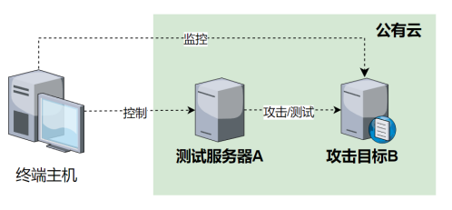

## 使用说明

### 基本目标

通过向目标域名解析服务器发送特定请求，使目标服务器服务质量下降或无法提供服务，形成拒绝服务攻击。

### 软件环境

DNSSEC拒绝服务攻击中共需要4种软件，如下表所示，其中主要测试对象为目录中的拒绝服务攻击工具dtool和辅助攻击工具rogue-ns，dig工具用于从客户端发起DNS查询并查看解析结果,docker用于运行必要的DNS服务器和监控组件容器。

| 软件名称 | 版本 | 作用 | 备注 |
| ------- | ---- | ---- | ---- |
|拒绝服务攻击工具|v1.0|发送拒绝服务攻击请求||
|辅助攻击工具|v1.0|辅助进行拒绝服务攻击||
|dig|9.11.36|发起DNS查询并查看解析结果||
|docker|24.0.5|安装必要容器||

### 硬件环境

测试中共需要三台服务器A，B和C。服务器均为公有云VPS，基本配置为Intel(R) Xeon(R) Platinum 8269CY CPU双核4GB内存。

|硬件名称|数量|配置|作用|
|---|---|---|---|
|公有云VPS|3|Intel(R) Xeon(R) Platinum 8269CY CPU双核4GB内存|安装运行必要软件|

### 测试拓扑

测试拓扑如下图。

### 部署方法

#### 目标及监控部署

在服务器B上通过docker安装BIND9容器作为攻击目标，安装cadvisor，prometheus和grafana进行服务器B的状态监控。

#### 拒绝服务攻击工具部署

将可执行文件dtool移动到服务器A上。

#### 辅助攻击工具部署

将可执行文件rogue-ns移动到服务器C上。

### 使用方法

#### 辅助攻击工具

|参数|说明|示例|
|---|---|---|
|-sld|攻击中使用的二级域名|echodns.xyz|

#### 拒绝服务攻击工具

|参数|说明|示例|
|---|---|---|
|query|攻击中使用的二级域名|echodns.xyz|
|-p|目标端口|53|
|-d|攻击中使用的域名后缀|rogue.echodns.xyz|
|-R|是否进行域名随机生成，布尔型参数||
|-r|发送请求速率|100|
|-n|发送请求总量|10000|

### 测试方法

1. 在服务器B上启动BIND9容器；
2. 在服务器C上执行命令`./rogue-ns -sld echodns.xyz`，启动辅助攻击工具；
3. 在服务器A上执行命令`./dtool query {ip} -p 5353 -R -d rogue.jtfgzlm.icu -r 300 -n 60000`，启动拒绝服务攻击脚本向目标进行攻击；
4. 通过服务器B上3000端口的grafana仪表盘监控目标状态；
5. 在服务器A上使用dig向目标进行DNS查询，通过解析时延和超时情况判断攻击效果。

