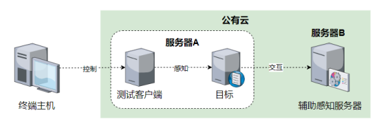

## 使用说明

### 基本目标

通过主动探测精确感知目标DNS服务的各项参数。

### 软件环境

目标感知中共需要3种软件，如下表所示，其中主要测试对象为目录中的目标感知工具fpdns_client和辅助感知工具fpdns_server，BIND9递归解析器作为感知目标。

| 软件名称 | 版本 | 作用 | 备注 |
| ------- | ---- | ---- | ---- |
|目标感知工具|v1.0|进行目标感知||
|辅助感知工具|v1.0|辅助进行目标感知||
|BIND9|9.11.36|作为感知目标||

### 硬件环境

测试中共需要2台服务器A和B。服务器均为公有云VPS，基本配置为Intel(R) Xeon(R) Platinum 8269CY CPU双核4GB内存。

|硬件名称|数量|配置|作用|
|---|---|---|---|
|公有云VPS|2|Intel(R) Xeon(R) Platinum 8269CY CPU双核4GB内存|安装运行必要软件|

### 测试拓扑

测试拓扑如下图。

### 部署方法

#### 感知目标部署

在服务器A上安装BIND9，设置模式为递归解析模式。

#### 目标感知工具部署

将可执行文件fpdns_client移动到服务器A上。

#### 辅助感知工具部署

将可执行文件fpdns_server移动到服务器C上。

### 使用方法

#### 辅助感知工具

|参数|说明|示例|
|---|---|---|
|-sld|感知中使用的二级域名|echodns.xyz|

#### 拒绝服务攻击工具

|参数|说明|示例|
|---|---|---|
|-target|感知目标的IP地址|1.2.3.4|

### 测试方法

1. 在服务器A上启动BIND9递归解析器；
2. 在服务器B上执行命令`./fpdns_server -sld echodns.xyz`，启动辅助感知工具；
3. 在服务器A上执行命令`./dtool -target {ip}`，进行目标感知
4. 等待感知完毕，通过输出结果判断感知效果

