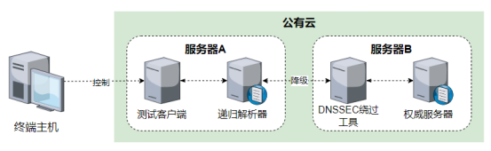

## 使用说明

### 基本目标

使目标DNS解析器不对DNSSEC记录进行验证，实现针对DNSSEC的降级攻击

### 软件环境

DNSSEC降级攻击中共需要四种软件，如下表所示，其中主要测试对象为目录中的DNSSEC绕过工具脚本proxy.py，BIND9用于搭建权威服务器和递归解析器，dig工具用于从客户端发起DNS查询并查看解析结果，python用于运行DNSSEC绕过工具。

| 软件名称 | 版本 | 作用 | 备注 |
| ------- | ---- | ---- | ---- |
|DNSSEC绕过工具|v1.0|实现中间人篡改功能|proxy.py|
|BIND9|9.18.2|搭建权威服务器和递归解析器||
|dig|9.11.36|发起DNS查询并查看解析结果||
|python|3.7.2|运行DNSSEC绕过工具||

### 硬件环境

测试中共需要三台服务器A和B。服务器A和B均为公有云VPS，基本配置为Intel(R) Xeon(R) Platinum 8269CY CPU双核4GB内存。

|硬件名称|数量|配置|作用|
|---|---|---|---|
|公有云VPS|2|Intel(R) Xeon(R) Platinum 8269CY CPU双核4GB内存|安装运行必要软件|

### 测试拓扑

测试拓扑如下图。

### 部署方法

#### BIND9部署

在服务器B上安装并配置BIND9作为权威服务器，并进行权威域的DNSSEC配置。
在服务器A上安装并配置BIND9作为递归解析器，开启DNSSEC验证功能。

#### DNSSEC绕过工具部署

在服务器B上安装python3，将proxy.py脚本移动到服务器上。

### 工具使用方法

DNSSEC绕过工具无输入参数，直接通过`python3 proxy.py`运行。

### 测试方法

1. 在服务器B上启动权威服务器，监听9999端口；
2. 在服务器B上执行python3 proxy.py命令，启动DNSSEC绕过工具；
3. 在服务器A上使用dig向本地的递归解析器查询ns3.jtfgzlm.icu，通过解析结果验证DNSSEC降级攻击效果

